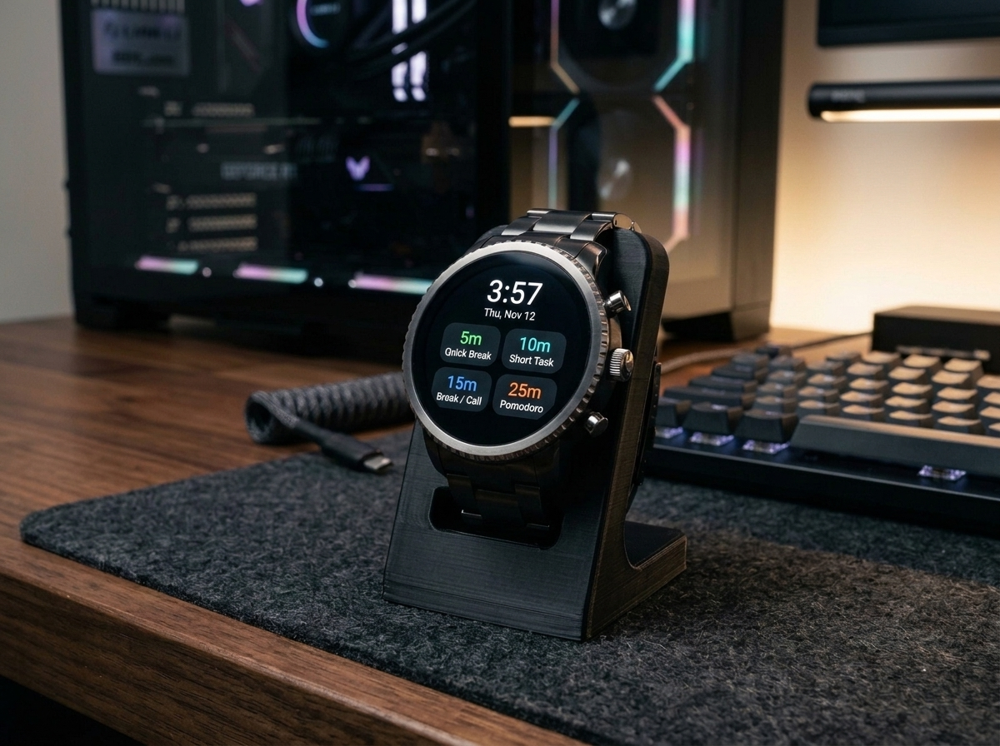
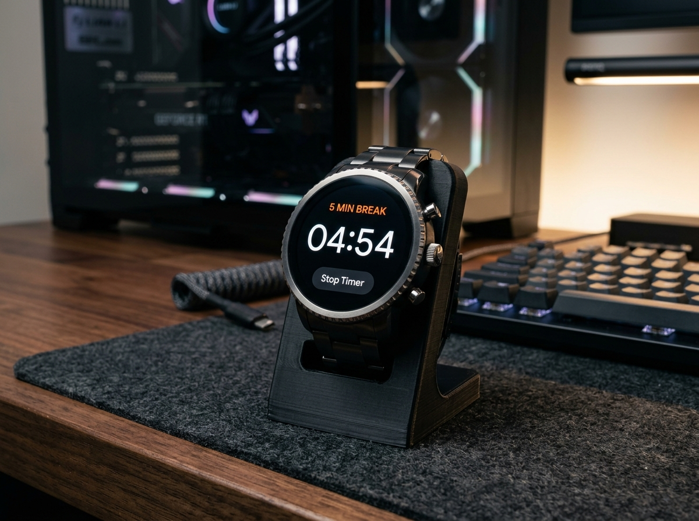
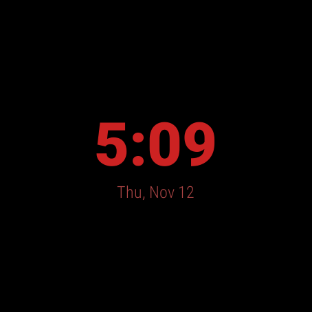
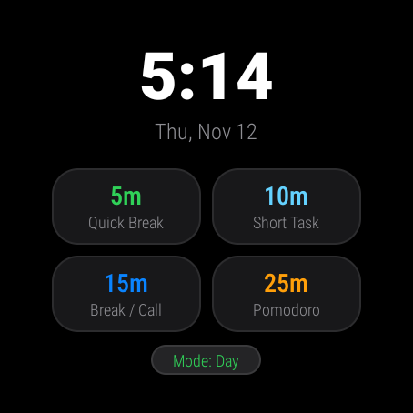
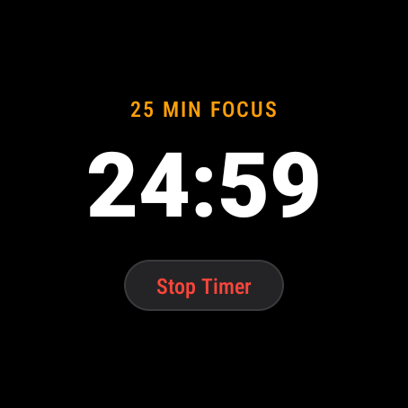
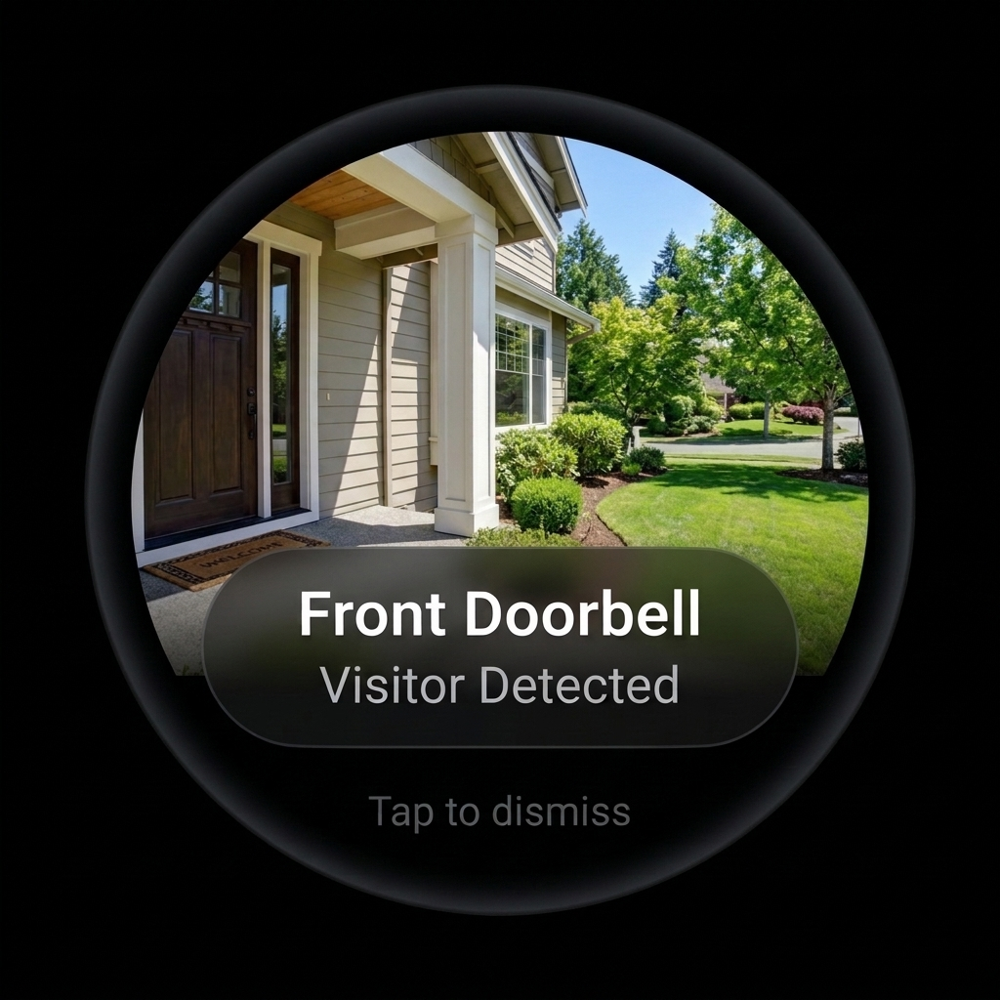
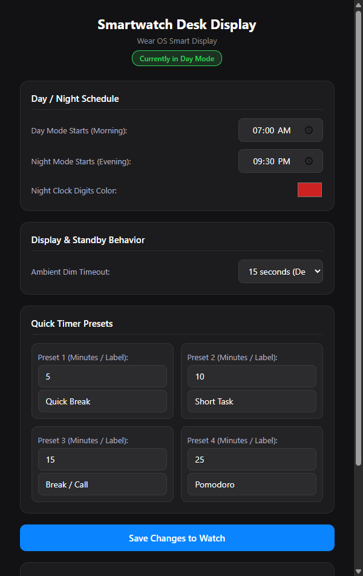

# Desk Smart Display & Focus Timer for Wear OS

Turn an unused Wear OS / Android smartwatch (e.g. Fossil Gen 4 Explorist HR) into a dedicated desk-docked smart display, productivity focus timer, and Home Assistant live alert screen.

<p align="center">
  
  &nbsp;&nbsp;
  
</p>

<p align="center">
  
  &nbsp;&nbsp;
  
  &nbsp;&nbsp;
  
  &nbsp;&nbsp;
  
</p>

---

## Highlights

- 🕰️ **Ambient Standby Clock**:
  - Displays a high-contrast minimalist clock and date on a pure black (`#000000`) AMOLED background (pixels turned off).
  - **AMOLED Burn-In Protection**: Subtly shifts coordinate padding every 3 minutes.
  - **Automatic Day / Night Shift**: Shifts digits to warm night-vision red (`#CC2222`) in the evening and clean white in the morning based on your schedule.
  - Keeps normal panel brightness so night digits remain crisp and legible without screen wash.
- ⏱️ **Tap-to-Wake Focus Timers**:
  - Tapping the screen reveals 4 customizable quick timer blocks (e.g. `5m`, `10m`, `15m`, `25m` Pomodoro).
  - Tapping any preset launches a full-screen `mm:ss` countdown with stop/cancel controls.
  - When the countdown finishes, plays a distinct multi-pulse haptic vibration alarm and wakes the screen.
  - Auto-dims back to the standby clock after a configurable inactivity timeout.
- 🔔 **Instant Doorbell & Camera Overrides**:
  - Seamlessly integrates with **Home Assistant** via simple local HTTP webhooks.
  - When the doorbell rings, wakes the watch, triggers haptics, and displays a live snapshot from your security camera over any running timer.
  - Auto-dismisses after 12 seconds and resumes the previous timer or clock.
- 🌐 **Embedded Web Configuration Portal**:
  - The watch hosts its own web UI directly on port `8080` (`http://<WATCH_IP>:8080/`).
  - Configure Day/Night schedules, colors, dimming timeouts, and timer block durations from any PC or phone browser on your local network.
- 🔌 **Dock-Friendly (OEM Charging Screen Disabled)**:
  - Disables the intrusive Fossil charging animation (`com.fossil.charge.firefish`) so the watch remains on your custom desk display 24/7 while charging.
- 🔒 **100% Local & Privacy-First**:
  - Zero cloud dependencies, zero external accounts, no phone pairing required. Everything runs locally on your LAN.

---

## Project Structure

```text
├── app/
│   └── src/main/
│       ├── java/com/fossil/deskalert/
│       │   ├── AlertActivity.java      # Full-screen doorbell camera popup
│       │   ├── AlertService.java       # Local HTTP server & web settings UI
│       │   ├── BootReceiver.java       # Auto-launches app on device reboot
│       │   ├── MainActivity.java       # Ambient clock, timers & animations
│       │   └── SettingsManager.java    # SharedPreferences persistence & schedule logic
│       ├── res/
│       │   ├── drawable/               # Modern dark-mode card and button drawables
│       │   └── layout/                 # Circular smartwatch layout definitions
│       └── AndroidManifest.xml         # Fullscreen kiosk flags & permissions
├── docs/
│   ├── screenshots/                    # Real device display captures
│   └── home_assistant_automation_example.yaml # Home Assistant automation blueprints
├── scripts/
│   ├── build_and_install.ps1           # Standalone compilation & deployment script
│   └── setup_watch_dock_mode.ps1       # ADB setup to disable OEM charging screens
└── README.md
```

---

## Hardware Compatibility & 3D-Printed Stand

Tested and optimized on:
- **Device**: Fossil Explorist HR (Gen 4 / FTW4012)
- **SoC**: Qualcomm Snapdragon Wear 2100 (4x Cortex-A7 @ 1.2 GHz)
- **RAM**: 512 MB
- **Display**: 1.39" Circular AMOLED (454 x 454 px, 328 ppi)
- **OS**: Android 9.0 Pie (Wear OS 2.x, API level 28)

*Compatible with any Android / Wear OS watch running Android 7.0+ (API 24+) with Wi-Fi and ADB debugging enabled.*

---

## Quick Setup

### 1. Enable ADB on the Watch
1. On the watch, go to **Settings > System > About**.
2. Tap **Build number** 7 times to enable Developer Options.
3. Go to **Settings > Developer options**:
   - Turn **ADB debugging** ON.
   - Turn **Debug over Wi-Fi** ON.
   - Note the IP address shown (e.g. `<WATCH_IP>:5555`).

### 2. Configure Dock Mode (Disable OEM Charging Ring)
Run the setup script from PowerShell:

```powershell
.\scripts\setup_watch_dock_mode.ps1 -WatchIP "<WATCH_IP>"
```

This disables `com.fossil.charge.firefish` and configures Android power settings so the watch never drops into the charging screensaver while docked.

### 3. Build & Deploy

Run the build script to compile and push the app directly over Wi-Fi:

```powershell
.\scripts\build_and_install.ps1 -WatchIP "<WATCH_IP>"
```

*Requirements: JDK 8+ and Android SDK Build-Tools.*

---

## Web Configuration Portal

Open your browser to:

```text
http://<WATCH_IP>:8080/
```

<p align="center">
  
</p>

| Setting | Default | Description |
|---|---|---|
| **Day Mode Starts** | `07:00` | Switches clock digits to crisp white |
| **Night Mode Starts** | `19:00` | Switches clock digits to night-vision red |
| **Night Clock Color** | `#CC2222` | Hex color for night mode text |
| **Ambient Timeout** | `15 seconds` | Time of inactivity before controls fade back to clock |
| **Presets 1 - 4** | `5m`, `10m`, `15m`, `25m` | Minutes and labels for quick focus timers |

---

## HTTP API Reference

The embedded micro-server on the watch listens on port `8080`:

### `POST /notify`
Triggers a live alert popup with haptic vibration and optional camera snapshot.

```json
{
  "title": "Front Door",
  "message": "Visitor at the door",
  "image": "http://<HOME_ASSISTANT_IP>:8123/local/doorbell_snapshot.jpg",
  "duration": 14,
  "vibrate": true
}
```

### `POST /timer`
Remotely triggers a timer countdown on the watch.

```text
POST http://<WATCH_IP>:8080/timer?minutes=25&label=POMODORO
```

### `GET /api/settings`
Returns current active settings as JSON.

### `POST /api/settings`
Updates settings directly via JSON payload.

---

## Home Assistant Integration

See [`docs/home_assistant_automation_example.yaml`](docs/home_assistant_automation_example.yaml) for copy-paste Home Assistant automations to send doorbell snapshot popups whenever someone rings your video doorbell.

---

## License

MIT License. See [LICENSE](LICENSE) for details.
